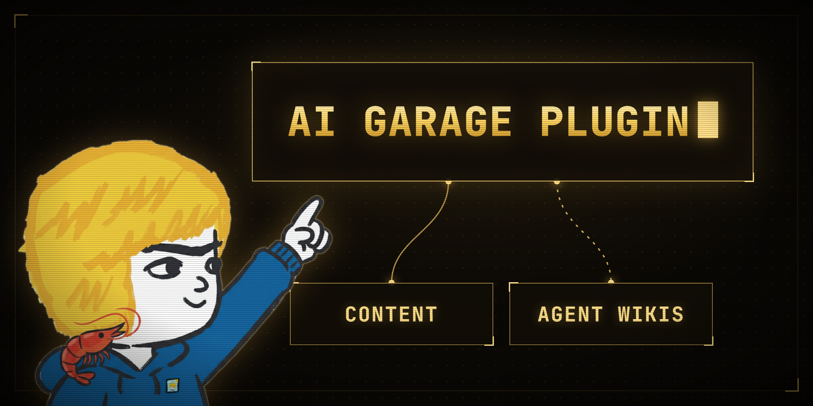

# AI Garage plugin



Search AI Garage's YouTube videos, newsletter and X posts, plus the Agent Wikis reference library, from inside your agent.

## What you get

Two hosted MCP servers (nothing runs on your machine):

- `aigarage` at `https://agentwikis.com/content/aigarage/mcp`. No key. Tools: `search_content`, `get_item`, `list_latest`. Videos come back with chapter timestamp links, newsletter issues with their page link, X posts as links only.
- `agentwikis` at `https://agentwikis.com/mcp`. Free without a key. Tools: `list_wikis`, `open_wiki`, `search`, `read_document`, `list_skills`, `read_skill`, `list_agent_tools`, `read_agent_tool`, `list_routines`, `read_routine`.

Three skills:

- `aigarage`: when to check AI Garage content and how to cite it.
- `agentwikis`: how to look something up in Agent Wikis.
- `skill-from-content`: turn a video or newsletter issue into a local skill in which every step cites its source. It shows you the skill before saving it.

## Install

Claude Code:

    claude plugin marketplace add tonbistudio/aigarage-plugin
    claude plugin install aigarage@aigarage

Codex:

    codex plugin marketplace add tonbistudio/aigarage-plugin
    codex plugin add aigarage@aigarage

Grok Build:

    grok plugin install tonbistudio/aigarage-plugin

Hermes:

    hermes plugins install tonbistudio/aigarage-plugin --enable

Cursor: install **AI Garage** from the Cursor Marketplace (cursor.com/marketplace), or in Cursor open Settings, then Plugins, and add `tonbistudio/aigarage-plugin`. Cursor reads `.cursor-plugin/plugin.json`.

Any other MCP client can add the two server URLs above directly.

## Agent Wikis Pro

Optional. Everything works on the free tier without a key. A key from https://agentwikis.com/pro unlocks XL wiki pages, Pro skills, agent tools and routines. It goes into the app's connection to `https://agentwikis.com/mcp`; nothing is installed. The same steps are on https://agentwikis.com/pro#connect.

- Claude Code: the plugin asks for the key when you enable it. To add or change it later, type `/plugin configure aigarage@aigarage` inside Claude Code, paste the key, and restart Claude Code.
- Codex:
  1. Save the key on your computer. On Windows, open PowerShell and run this, with your key in place of `aw_your_key` (keep the quotes). It prints `SUCCESS: Specified value was saved.`

     ```
     setx AGENTWIKIS_API_KEY "aw_your_key"
     ```

     On a Mac, run this instead (on Linux, use `~/.bashrc` in place of `~/.zshrc`):

     ```
     echo 'export AGENTWIKIS_API_KEY="aw_your_key"' >> ~/.zshrc
     ```

  2. Close the terminal app completely (every window, including Windows Terminal or VS Code if Codex runs there) and open it again. A new tab is not enough: it cannot see the key yet.
  3. Run `codex mcp add agentwikis --url "https://agentwikis.com/mcp" --bearer-token-env-var AGENTWIKIS_API_KEY`.
  4. Start a new Codex session. If Codex then shows no Agent Wikis tools at all, it cannot see the key: repeat step 2.
- Grok Build: run `grok mcp add --scope user agentwikis "https://agentwikis.com/mcp" --header "Authorization: Bearer aw_your_key"` with your key in place of `aw_your_key` (keep the quotes), then start a new Grok session.
- Hermes Agent: `hermes mcp add agentwikis --url "https://agentwikis.com/mcp" --auth header`, answer yes to authentication, and paste the key when asked.
- Cursor:
  1. Open **Customize** in the Cursor sidebar and find **AI Garage**.
  2. Click **Configure**, paste your key into **Agent Wikis Pro key (optional)** and save.
  3. Restart Cursor. Asking for a Pro skill now returns the full skill instead of a locked notice.

  Without the plugin, add the key to Cursor's own MCP settings instead: open `~/.cursor/mcp.json` (on Windows `%USERPROFILE%\.cursor\mcp.json`) and put this inside `"mcpServers": { }`, with your key in place of `aw_your_key`:

  ```
  "agentwikis": { "url": "https://agentwikis.com/mcp", "headers": { "Authorization": "Bearer aw_your_key" } }
  ```

  Save the file and restart Cursor.

In Codex, Grok Build and Hermes Agent the connection you add is named `agentwikis` and takes the place of the plugin's free one.

Keep the key private: a key typed into a command stays in the shell history, and Cursor keeps it in plain text in `mcp.json`. If it leaks, rotate it at https://agentwikis.com/pro. A key that isn't recognised (a typo, or an old key after rotating) gives the free tier, and every result says so.

Agent tools and routines run on your machine, never on the server. The agent shows you what one does and asks before saving, running or scheduling it. Each file it loads comes with a sha256.

## Data

The plugin installs no programs and runs nothing on your machine. It connects to two servers on agentwikis.com: your agent's searches go there, and the Pro key, if you add one, goes only to `https://agentwikis.com/mcp`. IP addresses are used in memory for rate limiting and are not stored; wiki searches are kept only as anonymous counts of the query text. Full policy: https://agentwikis.com/privacy

## Terms

See `TERMS.md`.
